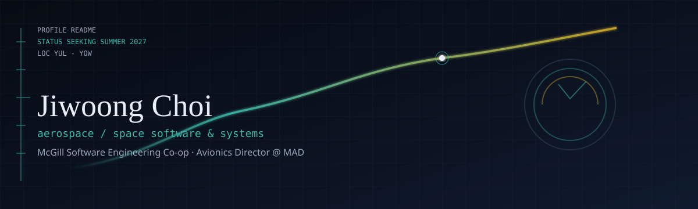

  

<h1 align="center">Hi, I'm Jiwoong</h1>

  McGill <strong>Software Engineering</strong> co-op (grad Dec 2027) · based in Montreal 
  Building at the seam of <strong>software × aerospace / space systems</strong> 
  <em>Avionics Director</em> @ McGill Aerial Design · ex Transport Canada CSL &amp; SET RPAS

  
  
  
  

---

### Right now
- 🛰️ **Avionics Director** at McGill Aerial Design — overall lead for a tilt-rotor VTOL UAV avionics stack (Cube Orange+, Jetson Orin Nano / YOLOv8, ZED 2i SLAM); I work with sub-team leads, review reports, and keep integration on track
- 🚀 Looking for **Summer 2027** internships in aerospace/space software, systems engineering, or product management
- ✍️ Co-author on an Aviation Safety Letter piece about RPAS BVLOS & detect-and-avoid ([issue](https://tc.canada.ca/en/aviation/publications/aviation-safety-letter/aviation-safety-letter-issue-3-2026) · [PDF p.15](https://tc.canada.ca/sites/default/files/2026-09/asl-3-2026-6.pdf))

### Recent work (snapshots)
**Transport Canada — CSL** *(May–Aug 2026)* — launch-vehicle trajectory sims in **ASTOS**; VM setup for the sim environment; a **Python** script for parallel/batch runs; early work on a **rocket-launch application** tool for Canada.

**Transport Canada — SET RPAS** *(Sep 2025–Apr 2026)* — **Power Apps / Power Automate** for the **RPAS Declaration** workflow; early **Mission Planner (C#)** **ED-318** geozone viewer with **DSST-style** overlays; UAV occurrence analysis for management; technical review comments on **ICAO RPAS** manual working materials.

**Lohas Medi** *(Seoul, Summer 2025)* — inventory/compliance system for medical supplies; data models, backend layout, roles; **Java + SQL**.

**CoolSupplies** *(ECSE 223)* — led the team: researched real API hooks, split the work, and divided tasks across teammates (Java / Gherkin).

### Spotlight
**QueueCare** — McHacks12 (Jan 2025). AI chatbot / ER queue tool on an LLM API (**GPT-4 + Gumloop**, React). **3rd of 133 teams** · **Gumloop Best AI Project**.

### Toolkit

  

Also in the bag: **ASTOS**, Mission Planner, Cube Orange+, Jetson Orin Nano, OpenCV / YOLOv8, Power Apps & Automate, VHDL, Assembly.

### Quick facts
| | |
|---|---|
| 🗣️ | English & Korean (fluent) · French (basic) |
| 📍 | Montreal ↔ Ottawa thread (McGill · Transport Canada) |
| 🎓 | ACI-ICAO Aerodrome Certification (Sep 2026) · Model ICAO Safety Delegate (2026) |

### Say hi
📧 **jiwoong.choi@mail.mcgill.ca** · always happy to talk aerospace software, RPAS, or student avionics.

<!-- Portfolio: jiwoongchoi.com — chosen domain, pending his purchase / Pages setup -->
